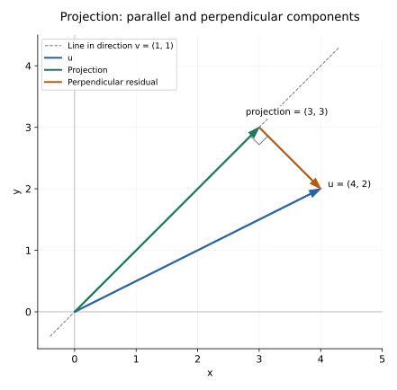

# Exercise 6 — Projection and Perpendicular Component

[Exercise sheet](../../../exercises/2_Geometry/01_vectors_en.md)

## Problem

Find the projection of $u=(4,2)$ onto the direction $v=(1,1)$. Then compute

$$
r=u-\mathrm{proj}_v\,u
$$

and verify that $r\cdot v=0$. Explain this result geometrically.

## Method

Project onto a nonzero direction and subtract to obtain the perpendicular component.

## Solution

Using the projection formula,

$$
\mathrm{proj}_v u=\frac{u\cdot v}{v\cdot v}v=\frac{6}{2}(1,1)=(3,3).
$$

Thus

$$
r=u-\mathrm{proj}_v u=(4,2)-(3,3)=(1,-1),
$$

and the requested calculation is

$$
r\cdot v=(1,-1)\cdot(1,1)=1-1=0.
$$

The projection $(3,3)$ is parallel to $v$, so it is the component of $u$ in the projection direction. Subtracting this parallel component leaves the perpendicular component $r$. The zero dot product verifies geometrically that $r$ is perpendicular to the direction $v$.

The projection is parallel to the given direction, while the residual is perpendicular.

## Verification

The decomposition reconstructs $u$: $(3,3)+(1,-1)=(4,2)$. The two components have dot product $3-3=0$, independently checking orthogonality.
