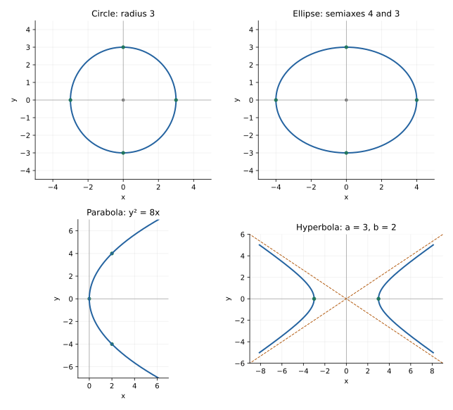

# Exercise 1 — Recognizing Curves from Canonical Form

[Exercise sheet](../../../exercises/2_Geometry/03_second_degree_curves_and_surfaces_en.md)

## Problem

Recognize the curves

$$
x^2+y^2=9,
$$

$$
\frac{x^2}{16}+\frac{y^2}{9}=1,
$$

$$
y^2=8x,
$$

$$
\frac{x^2}{9}-\frac{y^2}{4}=1.
$$

For each one, identify the most important features and make a sketch. Explain which parts of the equation let you recognize the type of curve.

## Method

Compare each equation with a canonical conic equation. Read the center or vertex, axis directions, and scale from its coefficients.

## Solution

### Circle

$x^2+y^2=9$ has equal positive coefficients of both squares. Its center is $(0,0)$ and its radius is $3$. The axis intercepts are $(\pm3,0)$ and $(0,\pm3)$.

### Ellipse

$x^2/16+y^2/9=1$ has two positive squared terms. Its center is $(0,0)$, with horizontal semiaxis $4$ and vertical semiaxis $3$. Its intercepts are $(\pm4,0)$ and $(0,\pm3)$.

### Parabola

$y^2=8x$ contains only one squared variable. It has vertex $(0,0)$, symmetry axis $y=0$, and opens to the right. In the form $y^2=4px$, $p=2$, so its focus is $(2,0)$ and its directrix is $x=-2$.

### Hyperbola

$x^2/9-y^2/4=1$ has squared terms of opposite signs. It has center $(0,0)$, vertices $(\pm3,0)$, and two branches opening horizontally. Its asymptotes are

$$
y=\pm\frac23x.
$$

The intercepts and asymptotes determine the basic sketches below.

Canonical conics with axes, intercepts, and hyperbola asymptotes.

## Verification

The listed circle and ellipse intercepts satisfy their equations. The parabola contains $(2,\pm4)$, since $16=8(2)$. The hyperbola contains $(\pm3,0)$, since $9/9=1$; it has no intercept with the vertical axis.
