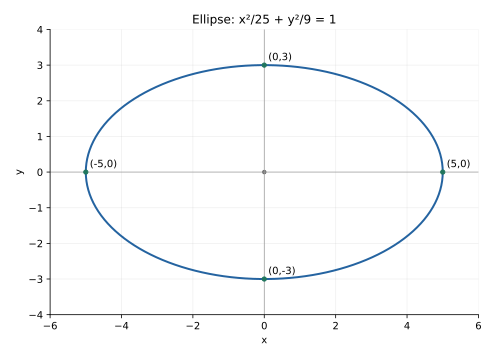

# Exercise 3 — Ellipse

[Exercise sheet](../../../exercises/2_Geometry/03_second_degree_curves_and_surfaces_en.md)

## Problem

For

$$
\frac{x^2}{25}+\frac{y^2}{9}=1,
$$

find the semiaxis lengths, the intercepts with the coordinate axes, and make a sketch. Explain along which axis the ellipse is more stretched and how this is visible in the equation.

## Method

The denominators of a centered ellipse equation are the squares of its semiaxis lengths.

## Solution

The ellipse is centered at the origin. Its horizontal and vertical semiaxis lengths are

$$
a=\sqrt{25}=5,\qquad b=\sqrt9=3.
$$

Setting $y=0$ gives $x=\pm5$, while setting $x=0$ gives $y=\pm3$.

**Axis intercepts**

$$
(5,0),\ (-5,0),\ (0,3),\ (0,-3).
$$

The major axis is horizontal: the larger denominator, $25$, permits a larger horizontal coordinate. The full axis lengths are $10$ and $6$.

Ellipse with horizontal semiaxis 5 and vertical semiaxis 3.

## Verification

Each horizontal intercept gives $25/25=1$, and each vertical intercept gives $9/9=1$. Reflection in either coordinate axis preserves the equation, matching the sketch.
