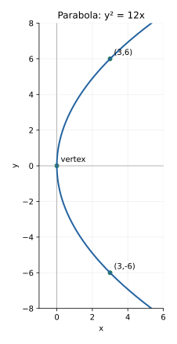

# Exercise 4 — Parabola

[Exercise sheet](../../../exercises/2_Geometry/03_second_degree_curves_and_surfaces_en.md)

## Problem

For

$$
y^2=12x,
$$

identify the vertex, axis of symmetry, and opening direction. Find points on the parabola for $x=3$ and use them to make a sketch.

## Method

Compare with $y^2=4px$ and obtain symmetric points by fixing the horizontal coordinate.

## Solution

The equation has vertex $(0,0)$ and symmetry axis $y=0$. Since $x=y^2/12\ge0$, the parabola opens to the right.

Here $4p=12$, so $p=3$. The focus is $(3,0)$ and the directrix is $x=-3$.

For $x=3$,

$$
y^2=12(3)=36,\qquad y=\pm6.
$$

Thus $(3,6)$ and $(3,-6)$ provide symmetric points for the sketch.

Right-opening parabola with vertex (0,0) and points (3,6) and (3,-6).

## Verification

Both points satisfy $y^2=36=12x$. Changing $y$ to $-y$ leaves the equation unchanged, confirming the horizontal symmetry axis.
