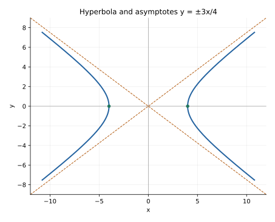

# Exercise 5 — Hyperbola and Asymptotes

[Exercise sheet](../../../exercises/2_Geometry/03_second_degree_curves_and_surfaces_en.md)

## Problem

For

$$
\frac{x^2}{16}-\frac{y^2}{9}=1,
$$

find the intercepts with the $x$-axis, the asymptotes, and make a sketch. Explain why the asymptotes describe the behavior of the curve far from the center.

## Method

Use the zero vertical coordinate to find the vertices. Remove the constant term to identify the asymptote directions.

## Solution

With $y=0$, the equation gives $x^2=16$. The intercepts are $(4,0)$ and $(-4,0)$.

The center is $(0,0)$ and the branches open along the horizontal axis. The asymptotes satisfy

$$
\frac{x^2}{16}-\frac{y^2}{9}=0,\qquad y=\pm\frac34x.
$$

Indeed, the hyperbola can be written as

$$
y=\pm\frac34\sqrt{x^2-16},\qquad |x|\ge4.
$$

As $|x|$ grows, $|y|/|x|$ approaches $3/4$. More precisely, the vertical difference from the corresponding asymptote has magnitude

$$
\frac34\left(|x|-\sqrt{x^2-16}\right)
=\frac{12}{|x|+\sqrt{x^2-16}}\longrightarrow0.
$$

This explains why the asymptote lines describe the distant branches.

Hyperbola with vertices at horizontal coordinates plus and minus 4 and asymptotes of slopes plus and minus 3/4.

## Verification

The vertices give $16/16=1$. For example, $(5,9/4)$ also lies on the curve: $25/16-(81/16)/9=25/16-9/16=1$.
