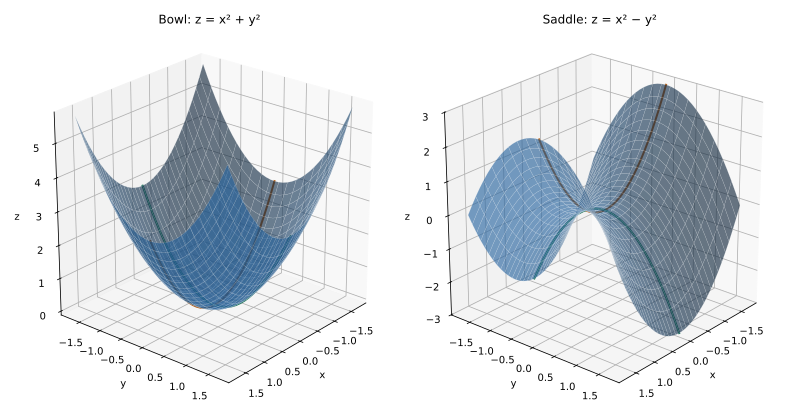

# Exercise 10 — Paraboloids

[Exercise sheet](../../../exercises/2_Geometry/03_second_degree_curves_and_surfaces_en.md)

## Problem

Compare

$$
z=x^2+y^2
$$

and

$$
z=x^2-y^2.
$$

For each surface, describe the cross-sections $x=0$, $y=0$, and $z=c$, then make a qualitative sketch.

## Method

Substitute fixed coordinates to obtain planar curves. Compare horizontal level curves and vertical parabolas.

## Solution

### Surface $z=x^2+y^2$

- At $x=0$, the section is $z=y^2$.
- At $y=0$, the section is $z=x^2$.
- At $z=c>0$, the section is the circle $x^2+y^2=c$, with radius $\sqrt c$.
- At $c=0$ there is one point; at $c<0$ there are no real points.

Both vertical parabolas open upward. The surface is a circular elliptic paraboloid, shaped like an upward-opening bowl.

### Surface $z=x^2-y^2$

- At $x=0$, the section is $z=-y^2$, opening downward.
- At $y=0$, the section is $z=x^2$, opening upward.
- At $z=c>0$, $x^2-y^2=c$ is a hyperbola opening along $x$.
- At $c<0$, $y^2-x^2=-c$ is a hyperbola opening along $y$.
- At $c=0$, the section is the pair of lines $y=\pm x$.

The surface is a hyperbolic paraboloid, with a saddle at the origin. Its opposite vertical curvatures distinguish it from the bowl.

An upward-opening bowl and a saddle, shown with their vertical cross-sections.

## Verification

For the first surface, $(1,0,1)$ and $(0,1,1)$ are both present. For the second, $(1,0,1)$ is present but the corresponding point on the vertical section at $x=0,y=1$ has height $-1$. This confirms the different curvatures.
