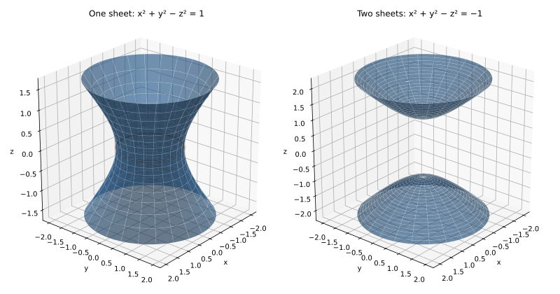

# Exercise 11 — Two Similar Surfaces

[Exercise sheet](../../../exercises/2_Geometry/03_second_degree_curves_and_surfaces_en.md)

## Problem

Compare

$$
x^2+y^2-z^2=1
$$

and

$$
x^2+y^2-z^2=-1.
$$

For several values $z=c$, check whether the cross-section exists and what its radius is. Based on this, describe qualitatively the difference between the surfaces and make sketches.

## Method

Write the radius of each horizontal section as a function of its height. Existence requires a nonnegative squared radius.

## Solution

For $x^2+y^2-z^2=1$, a section $z=c$ satisfies

$$
x^2+y^2=1+c^2.
$$

Every height gives a circle of radius $\sqrt{1+c^2}$. The smallest circle is at $c=0$, with radius $1$. The connected surface is a one-sheet hyperboloid about the vertical axis.

For $x^2+y^2-z^2=-1$, the section is

$$
x^2+y^2=c^2-1.
$$

It exists only for $|c|\ge1$. At $c=\pm1$ the section is a point; for larger $|c|$ it is a circle of radius $\sqrt{c^2-1}$. The two separated parts form a two-sheet hyperboloid about the vertical axis.

| Height | First surface | Second surface |
| --- | --- | --- |
| $c=0$ | Circle, radius $1$ | Empty |
| $c=\pm1$ | Circle, radius $\sqrt2$ | One point at each height |
| $c=\pm2$ | Circle, radius $\sqrt5$ | Circle, radius $\sqrt3$ |

One connected hyperboloid with a waist and a two-sheet hyperboloid with a vertical gap.

## Verification

Putting $x^2+y^2=1+c^2$ into the first equation gives $1$. Putting $x^2+y^2=c^2-1$ into the second gives $-1$. The second radius is not real for $|c|<1$, explaining the gap between its sheets.
