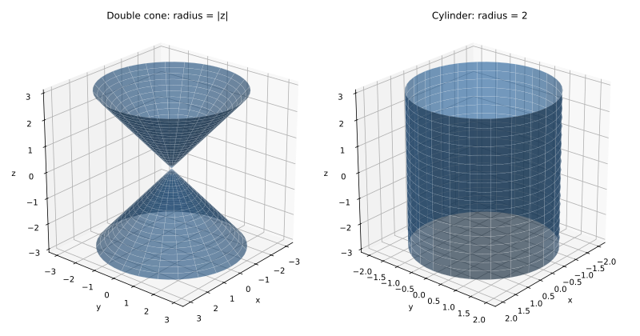

# Exercise 14 — Cone and Cylinder

[Exercise sheet](../../../exercises/2_Geometry/03_second_degree_curves_and_surfaces_en.md)

## Problem

Compare

$$
x^2+y^2=z^2
$$

and

$$
x^2+y^2=4.
$$

For each surface, describe the cross-sections $z=c$, $x=0$, and $y=0$, make a sketch, and explain why the radius of the cross-section depends on $z$ in the first case but is constant in the second.

## Method

Compare horizontal radii and the equations left in the two vertical coordinate planes.

## Solution

### Surface $x^2+y^2=z^2$

- At $z=c$, the section is a circle of radius $|c|$; at $c=0$ it is the origin.
- At $x=0$, the section is $y^2=z^2$, or the two lines $y=\pm z$.
- At $y=0$, the section is $x^2=z^2$, or the two lines $x=\pm z$.

This is a double circular cone with vertical axis and vertex at the origin. The horizontal radius grows with the distance from the vertex because the equation sets its square equal to $z^2$.

### Surface $x^2+y^2=4$

- At every $z=c$, the section is a circle of radius $2$.
- At $x=0$, the section consists of the two vertical lines $y=2$ and $y=-2$.
- At $y=0$, the section consists of the two vertical lines $x=2$ and $x=-2$.

This is a circular cylinder of radius $2$ with vertical axis. Its equation does not involve $z$, so its horizontal radius stays constant.

A double cone with height-dependent radius and a cylinder with constant radius.

## Verification

At heights $0,1,2$ the cone radii are $0,1,2$, while the cylinder radius remains $2$. Direct substitution of the listed vertical-section equations recovers the corresponding surface equations.
