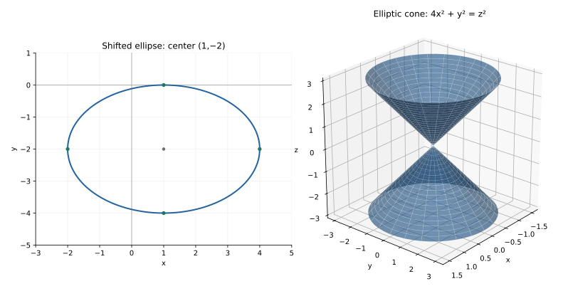

# Exercise 15 — Recognition and Sketch Without a Given Name

[Exercise sheet](../../../exercises/2_Geometry/03_second_degree_curves_and_surfaces_en.md)

## Problem

Consider the two equations:

$$
4x^2+9y^2-8x+36y+4=0,
$$

$$
4x^2+y^2=z^2.
$$

For the first equation, reduce it to canonical form, recognize the curve, give its most important features, and make a sketch.

For the second equation, do not begin by using a ready-made name for the surface. First describe the cross-sections $z=c$ and the cross-sections by the planes $x=0$ and $y=0$, paying attention to the different scales along the axes. Only then identify the surface and make a sketch.

## Method

Complete the square for the planar equation. For the spatial equation, analyze its sections first and identify the surface afterward.

## Solution

### First equation

Completing squares gives

$$
\begin{aligned}
4(x^2-2x)+9(y^2+4y)+4 &= 0, \\
4(x-1)^2+9(y+2)^2 &= 36.
\end{aligned}
$$

Hence the canonical form is

$$
\frac{(x-1)^2}{9}+\frac{(y+2)^2}{4}=1.
$$

It is an ellipse with center $(1,-2)$, horizontal semiaxis $3$, and vertical semiaxis $2$. Its four axis endpoints are $(-2,-2)$, $(4,-2)$, $(1,-4)$, and $(1,0)$.

### Second equation: sections before identification

For $4x^2+y^2=z^2$, a horizontal section $z=c\ne0$ is

$$
\frac{x^2}{c^2/4}+\frac{y^2}{c^2}=1.
$$

It is an ellipse with semiaxes $|c|/2$ along $x$ and $|c|$ along $y$. At $c=0$, only the origin remains.

At $x=0$, the section is the pair of lines $y=\pm z$. At $y=0$, it is $z=\pm2x$. Both horizontal semiaxes grow linearly with $|c|$, and the surface extends to positive and negative heights.

These sections identify a double elliptic cone with vertex at the origin and vertical axis. Its horizontal scale along $x$ is half the scale along $y$.

Shifted ellipse with its axis endpoints, followed by an elliptic cone that is narrower in the horizontal x direction.

## Verification

For the ellipse, each listed endpoint gives either $9/9$ or $4/4$, with the other term zero. For the cone at $z=2$, the points $(1,0,2)$ and $(0,2,2)$ both satisfy $4x^2+y^2=z^2$, confirming the different horizontal scales.
