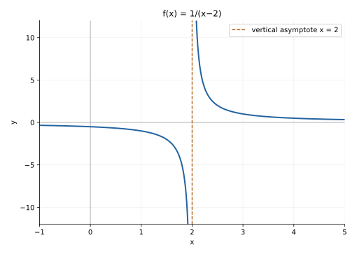

# Exercise 9 — One-Sided Limits and an Asymptote

[Exercise sheet](../../../exercises/3_Calculus/01_limits_en.md)

## Problem

Analyze the left-hand and right-hand limits of

$$
f(x)=\frac1{x-2}
$$

as $x\to2$. Does the two-sided limit exist? Interpret the result on a sketch of the graph and identify the vertical asymptote.

## Method

Track the sign and magnitude of the denominator on the two sides of the limiting point.

## Solution

As $x$ approaches $2$ from the left, $x-2$ is negative and approaches zero. From the right it is positive and approaches zero.

$$
\lim_{x\to2^-}\frac1{x-2}=-\infty,\qquad
\lim_{x\to2^+}\frac1{x-2}=+\infty.
$$

The one-sided limits disagree, so the two-sided limit does not exist, even as a single extended-real limit. The vertical asymptote is $x=2$.

The left branch falls without bound near the asymptote, while the right branch rises without bound. The branches remain separated because the function is undefined at $x=2$.

Separated branches of the reciprocal function with vertical asymptote x = 2.

## Verification

Take $x=2-1/m$ and $x=2+1/m$ for positive integers $m$. The function values are $-m$ and $m$, respectively, confirming the opposite one-sided behaviors.
