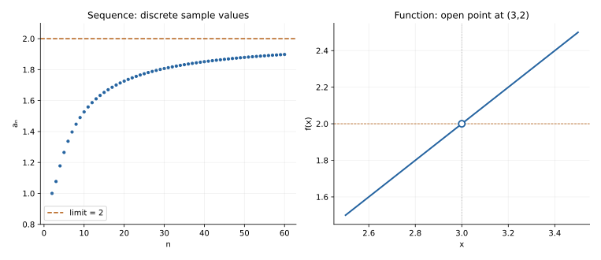

# Exercise 15 — Observation Versus Proof

[Exercise sheet](../../../exercises/3_Calculus/01_limits_en.md)

## Problem

Choose one sequence and one function from this set. For the sequence, compute several values for increasingly large $n$. For the function, prepare a table of values with arguments approaching the limit point from the left and right. Sketch the behavior of both objects.

Compare the observation with the analytical result and explain why a finite number of calculations or a sketch does not constitute a proof that the limit exists.

## Method

Choose an already studied sequence and function, compare numerical observations with their analytical limits, and distinguish samples from proof.

## Solution

### Sequence: Exercise 1

Choose $a_n=(4n^2-3n+1)/(2n^2+5n-7)$. A table of rounded values is

| $n$ | $a_n$ |
| --- | --- |
| $10$ | $1.52674897$ |
| $100$ | $1.93729566$ |
| $1000$ | $1.99352367$ |
| $10000$ | $1.99935024$ |

The values suggest a limit of $2$. Analytically, dividing by $n^2$ gives $(4-3/n+1/n^2)/(2+5/n-7/n^2)\to2$.

### Function: Exercise 7

Choose $f(x)=(x^2-4x+3)/(x-3)$, defined for $x\ne3$. On its domain, $f(x)=x-1$.

| Approach from the left | $f(x)$ | Approach from the right | $f(x)$ |
| --- | --- | --- | --- |
| $2.9$ | $1.9$ | $3.1$ | $2.1$ |
| $2.99$ | $1.99$ | $3.01$ | $2.01$ |
| $2.999$ | $1.999$ | $3.001$ | $2.001$ |

Both sides approach $2$. The sketch is the line $y=x-1$ with an open point at $(3,2)$, because the original function is undefined at $3$.

### Observation and proof

The tables and sketches agree with both analytical limits. They are evidence for intuition, but contain only finitely many sampled arguments. A sequence could change after the last listed index, and a function could behave differently between sampled points. The algebraic arguments control all sufficiently large indices or all sufficiently close arguments, which finite sampling does not establish.

Discrete sequence values approaching 2 and the punctured line approaching the open point (3,2).

## Verification

For the sequence, the error is exactly $(-13n+15)/(2n^2+5n-7)\to0$. For the function, $|f(x)-2|=|x-3|$ on its domain. These exact expressions justify the limits independently of the displayed samples.
