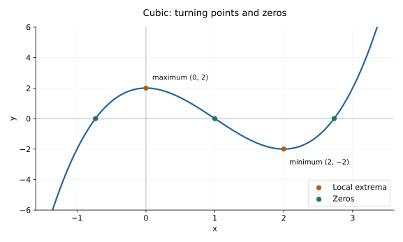

# Problem 1 — A Cubic Polynomial

[Exercise sheet](../../../exercises/3_Calculus/03_function_analysis_en.md)

## Problem

Analyze the monotonicity and extrema of

$$
f(x)=x^3-3x^2+2.
$$

Sketch the graph based on the results and mark the critical points.

## Method

Factor the first derivative and use its signs on the intervals separated by its zeros.

## Solution

The domain is $\mathbb R$. Differentiation gives

$$
f'(x)=3x^2-6x=3x(x-2).
$$

| Interval | $(-\infty,0)$ | $(0,2)$ | $(2,\infty)$ |
| --- | --- | --- | --- |
| Sign of $f'$ | $+$ | $-$ | $+$ |
| Behavior | Increasing | Decreasing | Increasing |

At zero the sign changes from positive to negative, giving a local maximum $(0,2)$. At two it changes from negative to positive, giving a local minimum $(2,-2)$. Neither is a global extremum because a cubic is unbounded in both directions.

For the sketch, $f(x)=(x-1)((x-1)^2-3)$ has zeros $1-\sqrt3,1,1+\sqrt3$. Also $f''(x)=6(x-1)$, so $(1,0)$ is an inflection point. The left tail tends to $-\infty$ and the right tail to $+\infty$.

The critical points and three zeros determine the turning shape of the cubic.

## Verification

Testing $x=-1,1,3$ gives derivative values $9,-3,9$. Also $f''(0)=-6$ and $f''(2)=6$ independently confirm the maximum and minimum.
