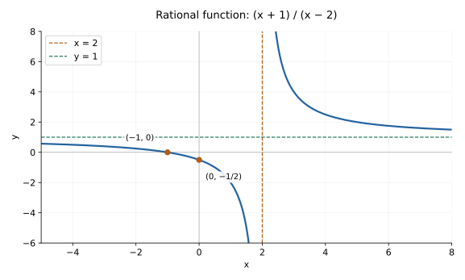

# Problem 3 — A Rational Function

[Exercise sheet](../../../exercises/3_Calculus/03_function_analysis_en.md)

## Problem

Analyze the domain, zeros, asymptotes, and monotonicity of

$$
f(x)=\frac{x+1}{x-2}.
$$

Finally, sketch a graph consistent with all the information obtained.

## Method

Separate the rational function into a constant and a reciprocal term, then analyze limits and the derivative on each domain interval.

## Solution

The denominator excludes $x=2$, so $D_f=\mathbb R\setminus\{2\}$. Its only zero is $x=-1$.

$$
f(x)=1+\frac3{x-2},\qquad f'(x)=-\frac3{(x-2)^2}<0.
$$

Thus the function is strictly decreasing separately on $(-\infty,2)$ and $(2,\infty)$. It has no local extrema. The limits are

$$
\lim_{x\to2^-}f(x)=-\infty,\qquad
\lim_{x\to2^+}f(x)=+\infty,\qquad
\lim_{x\to\pm\infty}f(x)=1.
$$

The vertical asymptote is $x=2$, and the horizontal asymptote is $y=1$. The left branch lies below $y=1$, and the right branch above it. The intercepts $(-1,0)$ and $(0,-1/2)$ locate the left branch.

The two decreasing branches are separated by the vertical asymptote; no curve segment connects across it.

## Verification

At $x=1$ and $x=3$, the function values are $-2$ and $4$, placing the branches on the predicted sides of the asymptotes. The identity $f(x)-1=3/(x-2)$ confirms the horizontal limit.
