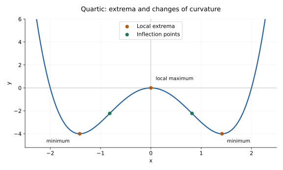

# Problem 8 — The Second Derivative

[Exercise sheet](../../../exercises/3_Calculus/03_function_analysis_en.md)

## Problem

For

$$
f(x)=x^4-4x^2
$$

find the local extrema, intervals of convexity and concavity, and inflection points. Sketch the graph and mark all the identified features on it.

## Method

Use the first derivative for extrema and the second derivative for curvature; a zero of the second derivative is an inflection point only if its sign changes.

## Solution

The domain is $\mathbb R$ and the function is even. Its derivatives are

$$
f'(x)=4x(x^2-2),\qquad f''(x)=12x^2-8.
$$

| Interval | $(-\infty,-\sqrt2)$ | $(-\sqrt2,0)$ | $(0,\sqrt2)$ | $(\sqrt2,\infty)$ |
| --- | --- | --- | --- | --- |
| Sign of $f'$ | $-$ | $+$ | $-$ | $+$ |
| Behavior | Decreasing | Increasing | Decreasing | Increasing |

The two minima are $(-\sqrt2,-4)$ and $(\sqrt2,-4)$; both are global. The point $(0,0)$ is a local maximum.

For curvature, $f''(x)>0$ when $|x|>\sqrt{2/3}$ and $f''(x)<0$ when $|x|<\sqrt{2/3}$. Thus the graph is convex (concave upward) on the two outer intervals and concave downward on the middle interval. The inflection points are

$$
\left(-\sqrt{\frac23},-\frac{20}{9}\right),\qquad
\left(\sqrt{\frac23},-\frac{20}{9}\right).
$$

The zeros are $-2,0,2$; zero is a double zero. Both tails tend to $+\infty$. These facts determine the symmetric W-shaped sketch.

Global minima, the central local maximum, and the two inflection points are marked.

## Verification

Completing the square gives $f(x)=(x^2-2)^2-4\ge-4$, independently proving that the two minima are global. Substituting $x^2=2/3$ gives $4/9-8/3=-20/9$ for each inflection height.
