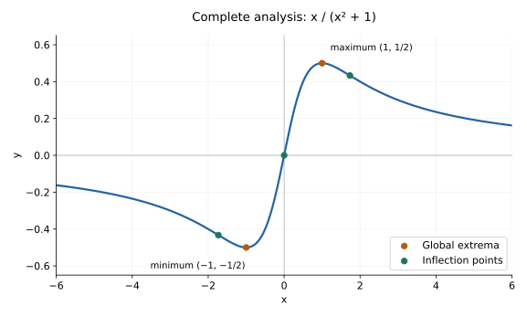

# Problem 10 — Complete Function Analysis

[Exercise sheet](../../../exercises/3_Calculus/03_function_analysis_en.md)

## Problem

Perform a complete analysis of

$$
f(x)=\frac{x}{x^2+1}.
$$

Include the domain, symmetry, zeros, limits, monotonicity, extrema, and convexity. Finally, produce a sketch based only on this information.

## Method

Combine domain and symmetry with a first-derivative sign chart and a second-derivative curvature chart.

## Solution

**Domain, symmetry, and limits.** The denominator is always positive, so $D_f=\mathbb R$. Since $f(-x)=-f(x)$, the function is odd. Its only zero is $(0,0)$. The limits at $-\infty$ and $+\infty$ are both zero, approached from below and above respectively. Thus $y=0$ is a horizontal asymptote, and there are no vertical asymptotes.

**Monotonicity and extrema.**

$$
f'(x)=\frac{1-x^2}{(x^2+1)^2}.
$$

The function decreases on $(-\infty,-1)$, increases on $(-1,1)$, and decreases on $(1,\infty)$. The minimum is $(-1,-1/2)$ and the maximum is $(1,1/2)$. They are global extrema.

**Curvature.**

$$
f''(x)=\frac{2x(x^2-3)}{(x^2+1)^3}.
$$

| Interval | $(-\infty,-\sqrt3)$ | $(-\sqrt3,0)$ | $(0,\sqrt3)$ | $(\sqrt3,\infty)$ |
| --- | --- | --- | --- | --- |
| Sign of $f''$ | $-$ | $+$ | $-$ | $+$ |
| Curvature | Concave downward | Convex | Concave downward | Convex |

Every listed sign change produces an inflection point:

$$
\left(-\sqrt3,-\frac{\sqrt3}{4}\right),\quad (0,0),\quad
\left(\sqrt3,\frac{\sqrt3}{4}\right).
$$

The sketch follows these limits, stationary points, symmetry, and changes of curvature.

Odd symmetry, global extrema, and three changes of curvature are shown.

## Verification

The inequality $2|x|\le x^2+1$ implies $|f(x)|\le1/2$, with equality at $x=\pm1$. This independently verifies that the two extrema are global.
