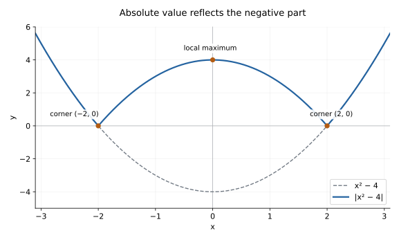

# Problem 12 — A Function with an Absolute Value

[Exercise sheet](../../../exercises/3_Calculus/03_function_analysis_en.md)

## Problem

Analyze

$$
f(x)=|x^2-4|.
$$

First sketch $x^2-4$, then explain the effect of the absolute value. Indicate the points where the derivative does not exist and justify the reason geometrically.

## Method

Reflect the part of $x^2-4$ below the axis upward, then differentiate on the resulting smooth pieces.

## Solution

The original parabola has vertex $(0,-4)$ and zeros at $\pm2$. Taking absolute values leaves its outer branches unchanged and reflects the middle part across the horizontal axis.

$$
f(x)=
\begin{cases}
x^2-4,&x\le-2\ \mathrm{or}\ x\ge2, \\
4-x^2,&-2<x<2. \\
\end{cases}
$$

The function is continuous, even, and nonnegative on all of $\mathbb R$. Its derivative is $2x$ on the outer open intervals and $-2x$ on the middle interval. Consequently it decreases on $(-\infty,-2)$, increases on $(-2,0)$, decreases on $(0,2)$, and increases on $(2,\infty)$.

There are global minima $(-2,0)$ and $(2,0)$, and a local maximum $(0,4)$. There is no global maximum. The outer pieces are convex and the middle piece is concave downward.

At each of $x=-2$ and $x=2$, the left slope is $-4$ and the right slope is $4$. Thus the derivative does not exist at either point. Geometrically, reflection produces sharp corners at the zeros of the original parabola, rather than smooth tangent lines.

Dashed: the original parabola. Solid: its absolute value, with the negative part reflected upward.

## Verification

At zero, the middle formula gives $f(0)=4$ and derivative zero. At each junction both branch values are zero, confirming continuity even though the one-sided slopes disagree.
