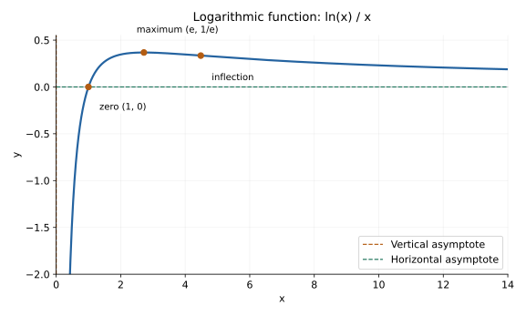

# Problem 13 — A Logarithm and an Asymptote

[Exercise sheet](../../../exercises/3_Calculus/03_function_analysis_en.md)

## Problem

Perform a complete analysis of

$$
f(x)=\frac{\ln x}{x},\qquad x>0.
$$

Find the maximum and the behavior at the ends of the domain. Explain which information is necessary for a correct sketch.

## Method

Respect the positive domain, then use logarithmic signs, endpoint limits, and the first two derivatives.

## Solution

The domain is $(0,\infty)$, with no symmetry about the origin or vertical axis. The only zero is $x=1$; $f(x)<0$ on $(0,1)$ and $f(x)>0$ on $(1,\infty)$.

$$
f'(x)=\frac{1-\ln x}{x^2}.
$$

The denominator is positive. Thus $f$ increases on $(0,e)$ and decreases on $(e,\infty)$. Its unique global maximum is $(e,1/e)$.

The endpoint behavior is

$$
\lim_{x\to0^+}\frac{\ln x}{x}=-\infty,\qquad
\lim_{x\to\infty}\frac{\ln x}{x}=0.
$$

For the first limit, set $x=e^{-t}$ to obtain $-te^t\to-\infty$. For the second, set $x=e^t$ to obtain $te^{-t}\to0$. The vertical asymptote is $x=0$, and the horizontal asymptote at infinity is $y=0$, approached from above. There is no minimum because the function is unbounded below.

For curvature,

$$
f''(x)=\frac{2\ln x-3}{x^3}.
$$

The graph is concave downward on $(0,e^{3/2})$ and convex on $(e^{3/2},\infty)$. Its inflection point is $(e^{3/2},3/(2e^{3/2}))$. The domain boundary, both limits, the zero, maximum, and curvature determine the sketch.

The zero, maximum, inflection point, and approach to the two asymptotes are marked.

## Verification

At $x=e$, the derivative numerator is zero and the value is $1/e$. At $x=e^{3/2}$, the second-derivative numerator is zero and changes sign because the logarithm is strictly increasing.
