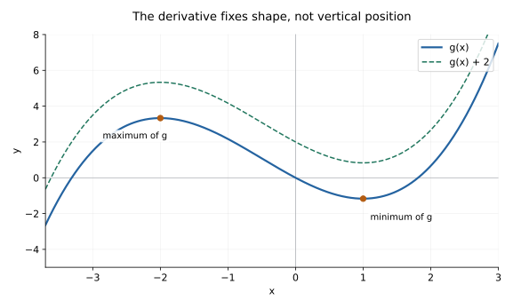

# Problem 14 — Reconstructing Information from the Derivative

[Exercise sheet](../../../exercises/3_Calculus/03_function_analysis_en.md)

## Problem

It is known that

$$
f'(x)=(x-1)(x+2).
$$

Determine the monotonicity and the locations of the extrema, and sketch a possible qualitative shape of the function. Then, for

$$
g(x)=\frac{x^3}{3}+\frac{x^2}{2}-2x
$$

verify that $g'(x)=(x-1)(x+2)$, and compare the specific graph with the earlier qualitative sketch.

## Method

Read the derivative signs without needing the unknown vertical position of the function.

## Solution

The two critical locations are $x=-2$ and $x=1$.

| Interval | $(-\infty,-2)$ | $(-2,1)$ | $(1,\infty)$ |
| --- | --- | --- | --- |
| Sign of $f'$ | $+$ | $-$ | $+$ |
| Behavior | Increasing | Decreasing | Increasing |

The sign change at $-2$ gives a local maximum; the sign change at $1$ gives a local minimum. The derivative alone does not determine their heights.

The proposed function satisfies

$$
g'(x)=x^2+x-2=(x-1)(x+2).
$$

Its extrema are $(-2,10/3)$ and $(1,-7/6)$. On a connected real domain, any other function with this derivative is $g(x)+C$. It has the same turning locations and monotonicity, with the whole graph translated vertically. The displayed graph of $g$ is therefore one valid realization of the qualitative sketch.

A possible function is g; a vertical translate has the same derivative and turning locations.

## Verification

The second derivative is $g''(x)=2x+1$, which is negative at $-2$ and positive at $1$. Test points $-3,0,2$ give first-derivative values $4,-2,4$, confirming the sign chart.
