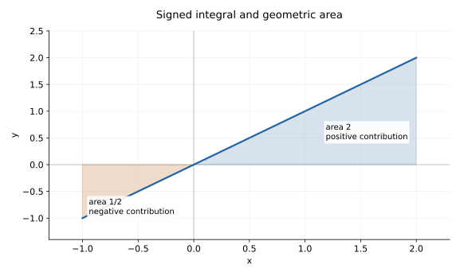

# Problem 9 — Definite Integral and Geometric Area

[Exercise sheet](../../../exercises/3_Calculus/04_integrals_en.md)

## Problem

Compute

$$
\int_{-1}^{2}x\,dx.
$$

Then separately compute the areas of the parts of the graph below and above the $x$-axis and explain the difference between the definite integral and geometric area.

## Method

Evaluate the signed integral, then split at the zero to compute the two nonnegative geometric areas.

## Solution

An antiderivative is $x^2/2$, so

$$
\int_{-1}^2x\,dx=\left[\frac{x^2}{2}\right]_{-1}^2
=2-\frac12=\frac32.
$$

The area below the axis is a right triangle with base and height $1$, hence $A_-=1/2$. The area above it is a right triangle with base and height $2$, hence $A_+=2$.

Thus the signed integral is $A_+-A_-=3/2$, while the total geometric area is

$$
A_++A_-=\frac52=\int_{-1}^2|x|\,dx.
$$

The integral counts the part below the axis negatively; geometric area counts both parts positively.

The lower triangle contributes negatively to the integral and positively to geometric area.

## Verification

Direct splitting gives $\int_{-1}^0x\,dx=-1/2$ and $\int_0^2x\,dx=2$. Their sum is $3/2$, whereas the sum of their absolute values is $5/2$.
