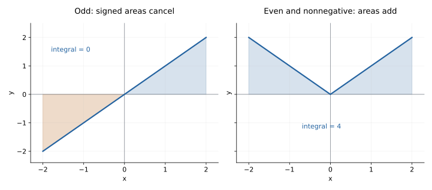

# Problem 12 — Symmetry, Sign, and Absolute Value

[Exercise sheet](../../../exercises/3_Calculus/04_integrals_en.md)

## Problem

Compare

$$
\int_{-2}^{2}x\,dx
$$

and

$$
\int_{-2}^{2}|x|\,dx.
$$

Before calculating, predict the results from symmetry and a sketch, then carry out the calculation and explain the difference.

## Method

Predict cancellation for an odd function and addition for its nonnegative, even absolute value, then integrate.

## Solution

The graph of $y=x$ has two equal triangles on $[-2,2]$, one below and one above the axis. Their signed contributions cancel, predicting zero. The graph of $y=|x|$ reflects the negative triangle upward, predicting a positive total area.

$$
\int_{-2}^2x\,dx
=\left[\frac{x^2}{2}\right]_{-2}^2=2-2=0.
$$

Using the evenness of $|x|$,

$$
\int_{-2}^2|x|\,dx=2\int_0^2x\,dx=2\cdot2=4.
$$

An odd integrand cancels over symmetric limits. Its absolute value instead adds the magnitudes of the two areas.

Equal signed areas cancel for x, but both contribute positively for its absolute value.

## Verification

Each right triangle has area $\tfrac12\cdot2\cdot2=2$. Subtracting gives $0$ for the first integral, and adding gives $4$ for the second.
