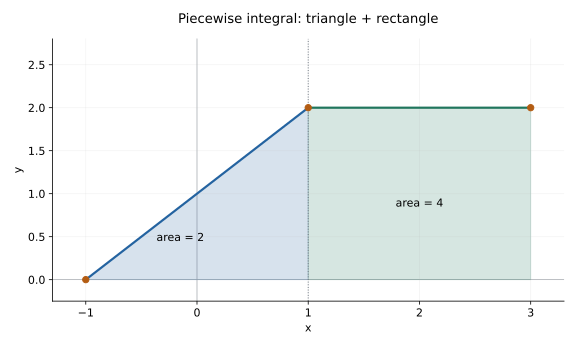

# Problem 14 — A Piecewise-Defined Function

[Exercise sheet](../../../exercises/3_Calculus/04_integrals_en.md)

## Problem

Let

$$
f(x)=
\begin{cases}
x+1,&-1\le x<1, \\
2,&1\le x\le3. \\
\end{cases}
$$

Sketch the graph, decide where to split the integral, compute

$$
\int_{-1}^{3}f(x)\,dx
$$

and verify the result geometrically.

## Method

Split the integral at the point where the formula changes, then compare with elementary areas.

## Solution

The graph rises linearly from $(-1,0)$ to $(1,2)$, then stays at height $2$ until $x=3$. The integral must be split at $x=1$:

$$
\begin{aligned}
\int_{-1}^3f(x)\,dx
&=\int_{-1}^1(x+1)\,dx+\int_1^3 2\,dx \\
&=\left[\frac{x^2}{2}+x\right]_{-1}^1+[2x]_1^3 \\
&=2+4=6.
\end{aligned}
$$

The value at the single boundary point does not change either integral; in this case the two formulas also agree at that point. The graph stays above the axis, so the signed integral equals its geometric area.

The split at x = 1 separates a triangular region from a rectangular one.

## Verification

The sloping part forms a triangle of base $2$ and height $2$, with area $2$. The constant part forms a rectangle of width $2$ and height $2$, with area $4$. Their sum is $6$.
