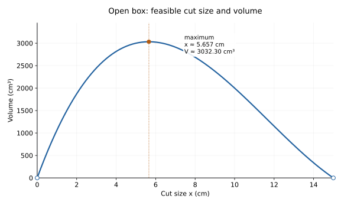

# Problem 3 — A Box Made from Cardboard

[Exercise sheet](../../../exercises/3_Calculus/05_applications_en.md)

## Problem

From a $30\,\mathrm{cm}\times40\,\mathrm{cm}$ sheet, squares of side length $x$ are cut from the corners and the edges are folded up to form an open box.

Write the volume as a function of $x$, determine the physically meaningful domain, and find the value of $x$ for which the volume is greatest.

## Method

Model the three dimensions after cutting, restrict the cut size, and locate the feasible critical point of the volume.

## Solution

Let $x$ be the cut size in centimetres. The box height is $x$, and its base has sides $30-2x$ and $40-2x$. Therefore

$$
V(x)=x(30-2x)(40-2x)=1200x-140x^2+4x^3,
\qquad 0<x<15.
$$

The domain keeps every dimension positive. The derivative equation is

$$
V'(x)=1200-280x+12x^2=4(3x^2-70x+300)=0.
$$

Its two roots are $(35\pm5\sqrt{13})/3$. Only the smaller one belongs to $(0,15)$:

$$
x_* =\frac{35-5\sqrt{13}}3\approx5.6574\,\mathrm{cm}.
$$

The derivative is positive before $x_*$ and negative after it throughout the feasible domain. Also $V(x)$ tends to zero at both domain ends, so this interior maximum is global. The larger root, about $17.676$, would produce a negative base dimension and is rejected.

The optimal base is approximately $18.6852\,\mathrm{cm}\times28.6852\,\mathrm{cm}$, and the maximum volume is approximately $3032.30\,\mathrm{cm}^3$.

Only cut sizes between 0 and 15 cm are physically valid; the interior peak gives the optimal box.

## Verification

At the feasible critical point, $V''(x_*)=24x_*-280=-40\sqrt{13}<0$. Substituting the original three dimensions into their product gives the same volume; the nearby cut sizes $5$ and $6$ give $3000$ and $3024$ cubic centimetres.
