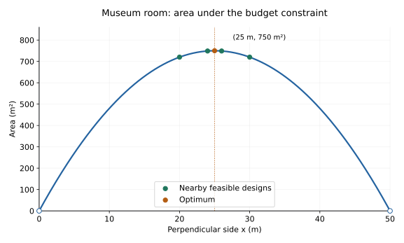

# Problem 12 — Complete Model and Computer Verification

[Exercise sheet](../../../exercises/3_Calculus/05_applications_en.md)

## Problem

A museum wants to create a rectangular exhibition room next to an existing straight wall. The side along the wall does not need to be built. The remaining three sides are to be constructed to two different standards: the two sides perpendicular to the wall cost $300\ \mathrm{PLN/m}$ each, while the side parallel to the wall costs $500\ \mathrm{PLN/m}$. The budget is $30\ 000\ \mathrm{PLN}$.

Build a model that maximizes the area of the room and prepare a complete analysis containing:

- definition of variables and units,
- mathematical model,
- domain resulting from the problem statement,
- computation of the derivative,
- determination and verification of the optimum,
- interpretation of the result,
- graph of the objective function,
- numerical verification of several values near the optimum found.

Finally, indicate which part of the solution required modeling the problem and which part was only the execution of the calculation. Produce the graph and computer calculations only after completing the mathematical solution, and treat them as verification.

## Method

Translate the unequal wall costs into a budget constraint, eliminate one length, and maximize area before using any graph or numerical calculation.

## Solution

**Variables and model.** Let $x$ metres be the length of each side perpendicular to the existing wall, and $y$ metres the new side parallel to it. The area is $A=xy$ square metres. The cost constraint is

$$
2\cdot300x+500y=30000\quad[\mathrm{PLN}].
$$

Using the full budget is appropriate: with a positive fixed $x$, increasing an affordable $y$ increases area. Solve the constraint to obtain

$$
y=60-\frac65x,\qquad
A(x)=60x-\frac65x^2.
$$

**Physical domain.** Both dimensions must be positive, giving $0<x<50$ metres. The endpoints would describe a degenerate room of area zero.

**Optimization.**

$$
A'(x)=60-\frac{12}{5}x=0
\quad\Longleftrightarrow\quad x=25.
$$

Then $y=30$. Since $A''(x)=-12/5<0$, the area is strictly concave and the stationary point is its unique global maximum. Equivalently,

$$
A(x)=750-\frac65(x-25)^2\le750.
$$

**Result:** build two perpendicular sides of $25$ m and one parallel side of $30$ m, giving a maximum area of $750\ \mathrm m^2$. The cost is $2\cdot300\cdot25+500\cdot30=30000$ PLN.

Choosing the two variables, counting the charged walls, and writing $600x+500y=30000$ are the modeling decisions. Substitution, differentiation, and solving the stationary equation execute that model. The graph and numerical calculations below are checks made after the mathematical optimum has been established.



The feasible area curve reaches its unique maximum at x = 25 m; nearby budget-feasible designs are marked.

## Verification

The following computer calculation evaluates the original budget equation and area near the optimum:

```python
for x in (20, 24, 25, 26, 30):
    y = (30000 - 600*x) / 500
    print(x, y, x*y)
```

| $x$ (m) | $y$ (m) | $A=xy$ (square metres) |
| --- | --- | --- |
| $20$ | $36$ | $720$ |
| $24$ | $31.2$ | $748.8$ |
| $25$ | $30$ | $750$ |
| $26$ | $28.8$ | $748.8$ |
| $30$ | $24$ | $720$ |

The nearby feasible designs have smaller areas, agreeing with the analytic result. A finite table and a plot do not alone establish a global maximum; strict concavity and the completed-square identity do.
